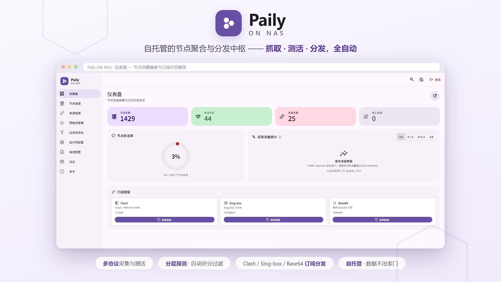

# Paily ON NAS

<p align="center">
  
</p>

> **把一台闲置的 NAS，变成你自己的节点聚合中枢。**

在 NAS 上自建节点聚合与订阅分发平台：抓取公开订阅源 → 去重 → 测活 → 评分 →
生成 Clash / Sing-box / Base64 订阅。


---

## 特色

- 🧩 **彻底自包含** —— 内联了上游已归档的依赖，不再依赖任何会消失的外部仓库
- ⚖️ **机场优先** —— 按优先级分配订阅名额，付费机场不会被海量免费节点稀释
- 💰 **额度可视** —— 自动读取机场额度与到期日，带额度头的机场自动识别
- 📊 **存活透明** —— 每个来源显示「存活 / 抓取」，一眼看出哪个源废了
- 🎨 **Material Design 3** —— 明暗双主题，桌面可折叠侧栏，手机自适应
- 🎯 **表达式筛选** —— 按延迟、地区、评分、来源优先级任意组合过滤，实时预览
- 📈 **流量对比**（可选）—— 接入 mihomo 后统计机场与公益节点的实际流量占比，
  支持按今天 / 近 7 天 / 近 30 天 / 全部查看，重启不丢历史

---

## ⚠️ 免责声明

> [!WARNING]
> **本项目仅供个人学习、技术研究与自用实验。**
> **严禁用于任何商业用途，或对外提供服务。**

<br>

> [!CAUTION]
> **订阅接口默认无任何认证** —— 任何能访问到端口的人都能拿到全部订阅内容。
> 请只在本地内网使用，**绝不要做公网端口映射**。

<br>

| | 你需要知道的 |
| :-- | :-- |
| **不提供节点** | 所有节点来自互联网公开的第三方订阅源，合法性、安全性与可用性由源方负责。本项目只做聚合、去重、测活与格式转换。 |
| **责任自负** | 请自行了解并遵守所在地关于网络访问、电信业务经营、计算机信息系统安全的法律法规。因使用本项目产生的一切后果由使用者承担。 |
| **无担保** | 按「现状」提供，可能造成数据丢失、服务异常、设备负载升高、账号被封禁等风险。 |
| **非官方分支** | 基于已归档的上游代码改造，与原作者无隶属关系。 |

> **这是技术学习项目，不是翻墙工具，更不是可以拿来运营的服务。**

完整条款见 **[docs/disclaimer.md](docs/disclaimer.md)** —— 不同意其中任何一条，请立即停止使用并删除本项目全部文件。

---

## 它做什么

```text
   订阅源 / 节点
        │
        ▼
   抓取 ──→ 去重 ──→ 测活 ──→ 评分 ──→ 分发
  （解析）  （合并）  （初筛+复筛） （EWMA）  （三种格式）
        │
        ▼
  /clash   /singbox   /base64
```

平台由四个服务组成，**通过 HTTP API 通信，没有代码级依赖**：

| 服务 | 职责 | 是否在本仓库 |
| --- | --- | --- |
| `paily-core` | 源库、节点池、去重、存活判定、评分、分发、管理 API | ✅ 就是本仓库 |
| `paily-fetch` | 下载订阅、解析、校验、上报 | 库代码已内联；服务需单独运行 |
| `paily-check` | 初筛与复筛 | 二进制在 Release，需单独运行 |
| `paily-ui` | Web 管理界面 | ✅ 源码在 `ui/` |

> `third_party/` 里内联的是 `paily-fetch` 的**库代码**（格式生成、节点模型）。
> 真正执行抓取的服务和二进制不在本仓库，编译期不依赖它，但**运行期需要**。

---

## 快速开始

```bash
# 1. 准备配置
cp .env.example .env
cp etc/core.yaml.example  etc/core.yaml
cp etc/check.yaml.example etc/check.yaml

# 2. 生成密钥，填入 .env（替换 CHANGE_ME_*）
echo "POSTGRES_PASSWORD=$(openssl rand -hex 16)"
echo "PAILY_ADMIN_PASSWORD=$(openssl rand -hex 16)"
echo "PAILY_SERVICE_SECRET=$(openssl rand -hex 24)"
echo "PAILY_JWT_SECRET=$(openssl rand -hex 32)"
echo "CHECKER_SECRET=$(openssl rand -hex 24)"

# 3. 下载配套二进制到 bin/（按架构选，见 Releases 页面）
#    bin/paily-fetch   bin/paily-check
chmod +x bin/paily-fetch bin/paily-check

# 4. 启动
docker compose up -d
```

> **三处密钥必须一致**
> `.env` 的 `CHECKER_SECRET`、`etc/core.yaml` 的 `checkers[0].secret`、
> `etc/check.yaml` 的 `core.secret` —— 三个值要完全相同。
> `checkers` 是列表，viper 无法用环境变量覆盖，只能写死在配置文件里。
> 不一致的表现是测活服务一直 401。

**订阅地址**

```
http://<NAS-IP>:21380/clash      Clash / mihomo
http://<NAS-IP>:21380/singbox    Sing-box
http://<NAS-IP>:21380/base64     通用 Base64
```

可选参数：`?preset=common|all|other`（地区策略）、`?tag=local`（测活视角）。

> ⚠️ **这些地址不需要任何认证**，任何能访问到端口的人都能拿到全部订阅。
> 请只在内网使用，**不要做公网端口映射**。

**管理界面**（可选）

```bash
cd ui && npm install && npm run build && cd ..
docker compose --profile ui up -d
# 访问 http://<NAS-IP>:21381
```

**常用运维命令**

```bash
docker compose ps                      # 状态
docker compose logs -f core            # 主服务日志
docker compose logs -f fetch           # 抓取日志（每轮打印各源结果）
docker compose logs -f check           # 测活日志（有进度条）

docker compose restart fetch           # 立刻触发一轮抓取
docker compose restart check           # 立刻触发一轮测活
docker compose restart core            # 改了运行时配置后重启重建缓存

# 备份数据库
docker compose exec postgres pg_dump -U paily paily | gzip > paily-$(date +%F).sql.gz

docker compose down                    # 停止（保留数据）
docker compose down && rm -rf data/    # 彻底重置（连数据库一起删）
```

---

## 文档

| 文档 | 内容 |
| --- | --- |
| [相对上游的改动](docs/changes-vs-upstream.md) | 死依赖、延迟筛选、优先级、流量统计、MD3 界面 |
| [构建与部署](docs/build-and-deploy.md) | 手动构建、交叉编译、目录结构、踩坑记录 |
| [配置与 API](docs/configuration-and-api.md) | 环境变量、运行时配置、**筛选表达式**、接口权限 |
| [免责声明](docs/disclaimer.md) | 完整法律条款 |
| [源管理](docs/source-management.md) | 订阅源格式、去重、失效判定 |
| [节点池](docs/node-pool.md) | 去重策略、多对多关联 |
| [评分机制](docs/scoring.md) | EWMA、延迟曲线、等级划分 |
| [分发策略](docs/distribution.md) | 地区选择、优先级占比、命名模板 |
| [模板](docs/templates.md) | Clash / Sing-box 配置模板 |
| [自动化路线](docs/automation-roadmap.md) | 待实现能力 |

---

## 平台支持

| 平台 | 支持 | 说明 |
| --- | --- | --- |
| **`linux/arm64`** | ✅ **主要目标** | 群晖、威联通、fnOS、极空间等主流 NAS；树莓派 4/5 |
| `linux/armv7` | ✅ 支持 | 32 位 ARM 老设备（测活并发要调低） |
| `linux/amd64` | ✅ 支持 | x86 NAS / 服务器 / 软路由 |
| `darwin-arm64` / `darwin-amd64` | ✅ 支持 | macOS，适合本地调试 |

> **x86 用户**：默认参数按 ARM NAS（8 核 / 7.6 GB）调优。x86 可把
> `INITIAL_CONCURRENCY` 提到 128~256、`FETCH_CONCURRENCY` 提到 32，
> 但 **`ulimits.nofile` 千万别调低**，这是硬性要求。

> **为什么抓取 3 小时、测活 2 小时？** 免费源本身就是几小时到一天才更新，
> 抓太勤没收益；而测活每轮要对上千节点发起 TCP 连接，在家宽上过于频繁可能
> 引起 ISP 侧异常。

---

## 常见问题

<details>
<summary><b>paily-fetch 报 `lookup core: no such host`</b></summary>

容器网络分裂。常见原因：改过 `docker-compose.yml` 里的 `name:` 字段，
导致新老容器在不同网络里。

```bash
docker compose down
docker network ls | grep paily
# 删除残留网络后重新 up
docker compose up -d
```

另外**不要给容器配自定义 `dns:`**，那会破坏 Docker 内嵌 DNS 的服务名解析。
</details>

<details>
<summary><b>订阅能打开但一个节点都没有</b></summary>

按顺序排查：

1. **节点池是空的** —— 管理界面看「节点总数」，如果为 0，说明抓取还没跑。
2. **全部节点已死** —— 看「存活节点」。免费节点存活率低到 2% 是常态。
3. **分发过滤器把所有节点排除了** —— 检查运行时配置 `node_distribute_filter`，
   这个表达式**返回 `true` 的节点会被排除**。
4. **测活还没跑过** —— 刚部署时节点都是 `alive=false`，等一轮测活（默认 2 小时）
   或临时把 `CHECK_CRON` 改小。

   > ⚠️ `CHECK_CRON` 是**六字段** cron（秒 分 时 日 月 周）。`*/N` 必须放在
   > **第 3 段（时）**才是「每 N 小时」；放在第 2 段（分）会变成「每 N 分钟」。
   > 想改成「每 30 分钟一次」应写 `0 */30 * * * *`；想改成「每 2 小时一次」
   > 应写 `0 0 */2 * * *`。**不要凭直觉把 `*/N` 往前挪一位。**
</details>

<details>
<summary><b>测活进度卡住不动、CPU 掉到 0%</b></summary>

文件描述符耗尽。容器默认 `ulimit nofile` 只有 1024，并发一高就会撞上。

本项目已在 `docker-compose.yml` 里把 `check` 服务的 `nofile` 提到 65536，
**不要调低也不要删**。ARM 上实测 128 并发就会触发。
</details>

<details>
<summary><b>客户端导入报 FormatException</b></summary>

Base64 订阅被加了换行或多余字符。确认用 `/base64` 而不是 `/clash`，
并且客户端支持对应格式。
</details>

---

## 开发

接口采用 **spec-first**：`api/openapi/spec.yaml` 是 API 契约的唯一来源，
服务端代码由 `oapi-codegen` 生成。

```bash
go install github.com/oapi-codegen/oapi-codegen/v2/cmd/oapi-codegen@v2.6.0
oapi-codegen -config oapi-codegen.yaml api/openapi/spec.yaml
```

约定：

- 不手动修改 `internal/api/generated/` 下的生成文件
- 业务实现在 `internal/api/handler/`，实现 `ServerInterface`
- 变更接口先改 `spec.yaml`，再生成，最后补齐 handler

**CI**（`.github/workflows/build.yml`）：每次 push/PR 跑 `go build` + `go vet`；
构建 5 个平台；打 `v*` 标签自动发 Release。

---

## 致谢

这个项目的每一行代码，都站在 [Paily Connect](https://github.com/openpaily) 团队的肩膀上。

2026 年，他们因为资源与精力有限，决定停止运营并开源全部核心代码。在那封告别信里，
他们写了这样一段话：

> 我们始终相信，开源不仅意味着分享代码，也意味着让一个项目拥有超越原本团队的可能。
> 今天，我们也成为了其中的一分子。
>
> ……
>
> 我们希望通过开源，让 Paily Connect 过去积累的一些代码和思路能够继续被看到、被研究，
> 也希望如果有人对这个项目感兴趣，可以在此基础上继续构建自己的服务。
>
> ……
>
> 保持前行，保持热爱。

这份 README 里提到的每一个「修正」和「新增」，本质上都是在他们打好的地基上继续盖房子。
内联依赖、补 `Latency` 字段、修 Dockerfile——如果不是他们先把架构搭清楚、把代码整理干净
并选择开源，这个分支根本不会存在。

感谢每一位使用过、反馈过问题、提供过建议，以及曾经关注过 Paily Connect 的人。

也感谢你读到这里。如果这个项目对你有一点用，那就够了。

**保持前行，保持热爱。**

---

## 许可

[AGPL-3.0](LICENSE)

